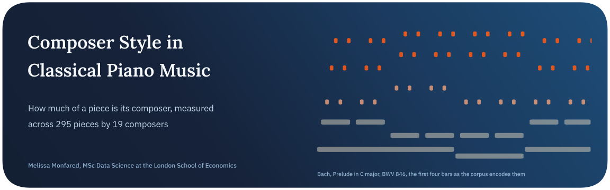
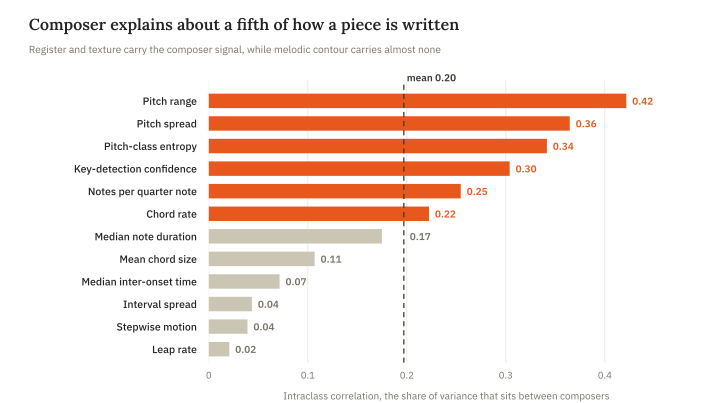
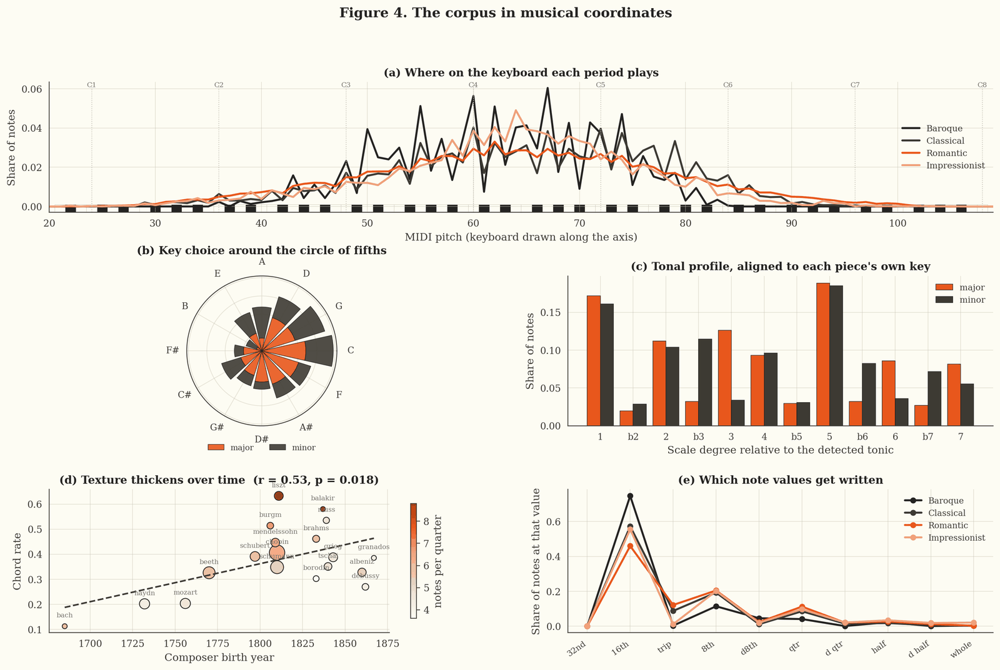
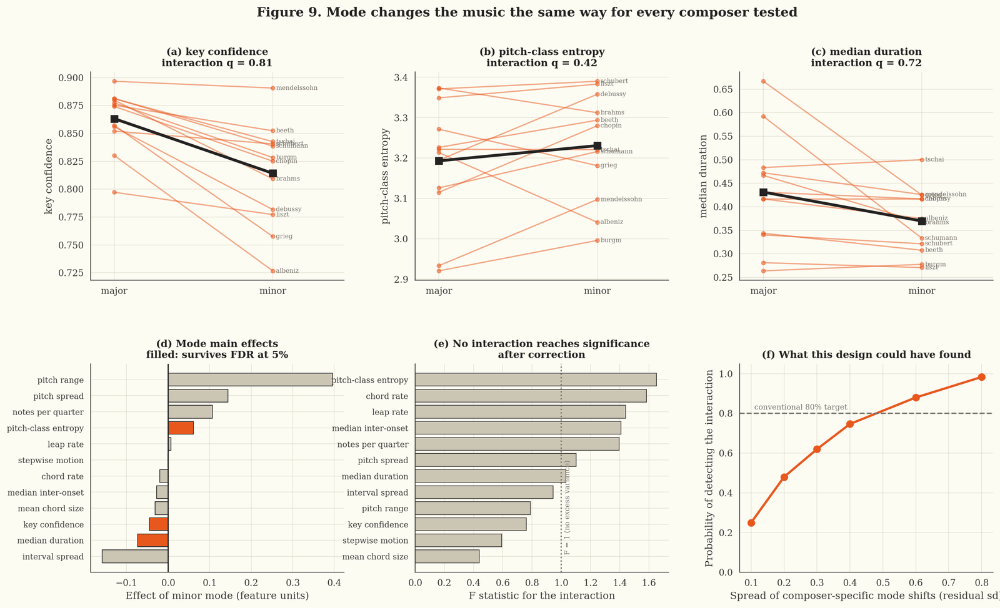
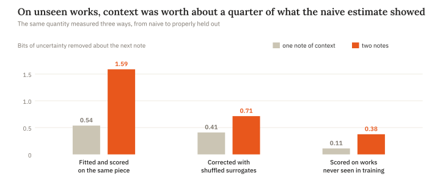
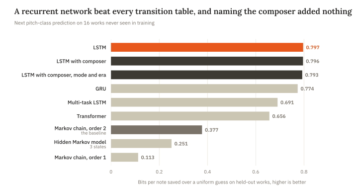
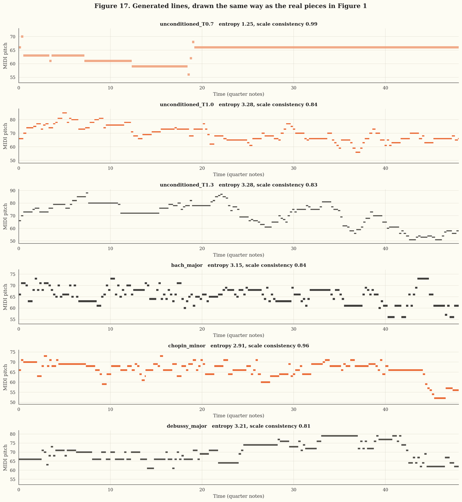

<p align="center">
  
</p>

<p align="center">
  
  
  
  
</p>

Most music-generation projects train a network and invite the listener to agree that its output sounds like Chopin. This project starts one step earlier and treats style as an estimation problem. If a composer’s style is a set of distributions over pitch, rhythm, texture and harmony, those distributions can be measured with honest uncertainty and then used as the target a generator has to hit.

The central question is whether that style holds still. A composer whose writing shifts the same way as everyone else’s when moving from major to minor has a fixed signature. A composer who responds to mode in their own way has a style that partly lives in the musical context, and a generator conditioned on composer alone would be modelling something incomplete. The analysis runs on 295 solo piano pieces by 19 composers, from Bach to Debussy, and ends with recurrent and Transformer models that generate melodies conditioned on composer and mode.

> **In short.** Composer identity explains about a fifth of the variation in how a piece is written, and the other four fifths sit between works by the same composer. Minor mode changes the music in the same direction for every composer tested, with no sign of a composer-specific response. The same weak composer signal shows up again on the generative side, where telling an LSTM who wrote a piece leaves its next-note predictions unchanged to within 0.001 bits.

## Key findings

| Finding | Evidence |
| :-- | :-- |
| A composer is a broad distribution, not a point | Averaged over twelve features, the composer level holds 0.197 of the variance. Pitch range carries the most at 0.42 and leap rate almost none at 0.02 |
| Minor mode shifts everyone the same way | Three of twelve features move under minor mode, led by lower key-detection confidence and higher pitch-class entropy, while none of the twelve Composer x Mode interactions survives a false-discovery-rate correction |
| The null has teeth | The design had 75% power against composer-specific mode shifts of 0.4 residual standard deviations, and the Bayesian estimate of their spread is 0.27 with a 95% interval from 0.02 to 0.62 |
| Apparent era effects came from counting pieces as independent | Nine of twelve features differ by era when every piece counts as evidence, and none does once each composer contributes a single mean |
| Naive estimates overstate musical memory | Two notes of context remove 1.59 bits of uncertainty measured naively, 0.71 after a surrogate bias correction and 0.38 on works the model never saw |
| A recurrent network clearly beats a transition table | The LSTM reaches 2.788 bits per note on held-out works against 3.208 for a second-order Markov chain, cutting perplexity from 9.24 to 6.91 |
| Conditioning steers generation without improving prediction | Adding the composer changes held-out loss by 0.0006 bits, yet it lifts a weak classifier’s probability on the intended composer for six of eight targets, from 0.059 to 0.093 on average |

<picture>
  <source media="(prefers-color-scheme: dark)" srcset="assets/icc-dark.svg">
  
</picture>

## Conclusion

The thread running through the whole notebook is that composer identity carries less information than most work in this area assumes. A mean intraclass correlation of 0.197 explains a chain of results that would otherwise look unconnected. Fingerprint clustering holds up only for the pre-Romantic composers and one virtuoso pair, a composer classifier reaches only 0.072 balanced accuracy once folds are grouped by work, conditioning a generator on composer barely moves its likelihood, and the composer embedding it learns bears no relation to the measured fingerprints. Four methods with different assumptions arrive at the same place, which is stronger evidence than any one of them would be alone.

Mode runs the other way. Minor keys shift the statistics consistently, and the shift has a plain musical explanation, since the variable sixth and seventh degrees of minor widen the set of pitch classes in use. What the data can’t find is a composer who responds to mode differently from the rest. The design was powerful enough to catch a moderate interaction three times in four, so a large one is ruled out and a small one remains possible.

On the generative side the LSTM earns its place, 0.42 bits per note better than the Markov baseline, but the second-order Markov chain captures 47% of the total improvement with 0.3% of the parameters. Sampling at temperature 1.0 matched real music best on both the feature comparison and a real-versus-generated discriminator, though the discriminator could still tell them apart with an AUC of 0.71. Several default procedures failed quietly along the way, an entropy estimator that overstated how much context helps, a sampler with 101 divergences, an EM fit stuck in a local optimum and a bidirectional LSTM that read the answer, and each one was caught by a check rather than by luck.

## The data

The corpus is the Kaggle `classical-music-midi` collection, a repackaging of the Piano-midi.de archive with 295 MIDI files by 19 composers, holding 722,431 notes between them. All 295 files parsed and no piece was excluded on quality grounds. Two features of the collection shape every result. Only 106 distinct works stand behind the 295 files, because many are movements of the same sonata or set, so every split and every resampling in the notebook is done at the level of the work. And the balance is uneven, with 14 of the 19 composers from the Romantic period, Chopin alone contributing 48 pieces and Balakirev a single one.

Key and mode aren’t recorded in the files, so they are estimated with the Krumhansl-Schmuckler algorithm, and its correlation coefficient travels with each piece as a measure of how much to trust the label. That coefficient orders the composers almost chronologically without being told anything about history, from 0.94 for Bach and 0.93 for Mozart down to 0.71 for Mussorgsky.



*The corpus in musical coordinates. Panel (c) rotates every piece to its own detected tonic, and the major and minor scales reappear on their own, with the flat third 3.5 times more common in minor and the major third 3.7 times more common in major.*

## Methods

| Question | Method | Result |
| :-- | :-- | :-- |
| How much of the variation is composer? | Variance components with composer as a random effect, fitted by REML | Mean intraclass correlation of 0.197 across twelve features |
| Do the eras differ? | ANOVA on pieces and again on composer means, with Benjamini-Hochberg correction | 9 of 12 features with pieces as the unit, 0 of 12 with composers |
| Does mode interact with composer? | Composer x Mode linear models on the twelve composers with three or more works in each mode, plus a power analysis by simulation | 3 mode main effects and no interactions, with 75% power against shifts of 0.4 residual standard deviations |
| How large is the interaction, with uncertainty? | Hierarchical Bayesian model in PyMC with partial pooling, reparameterised after the centred version produced 101 divergences | Spread of composer mode effects 0.27, 95% interval 0.02 to 0.62 |
| Do pitch-class profiles need log-ratio geometry? | Centred log-ratio transform and Aitchison distance | Spearman 0.968 with Euclidean distances, with 3 of 19 nearest neighbours changing |
| Do composers form stable groups? | Ward clustering of twelve-feature fingerprints, checked over 400 piece-level bootstraps | Haydn and Mozart together in every resample, while the Romantic composers don’t separate |
| How far back does musical memory reach? | Plug-in entropy, surrogate bias correction, held-out Markov chains and hidden Markov models | Second-order Markov at 3.208 bits beats every hidden Markov model tried |
| What does a neural network add? | Recurrent and Transformer next-note models, tuned over 11 configurations and compared on a conditioning ladder | LSTM at 2.788 bits, with conditioning moving the result by at most 0.010 bits |
| How good is the generated music? | Feature distributions compared by permutation tests on the energy distance, and a real-versus-generated discriminator | Temperature 1.0 best by both routes, with a discriminator AUC of 0.71 |



*Mode changes the music the same way for every composer tested. The top row follows each eligible composer from major to minor, and the power curve at bottom right shows what size of interaction the design could have found.*

<picture>
  <source media="(prefers-color-scheme: dark)" srcset="assets/rigour-dark.svg">
  
</picture>

<picture>
  <source media="(prefers-color-scheme: dark)" srcset="assets/models-dark.svg">
  
</picture>

## Generated music

The notebook writes 17 MIDI pieces. Ten are conditioned on five composers in both modes, and the rest are unconditioned samples and style-transfer pairs. The models predict pitch class only, so two things are supplied by rule rather than by the network. Octave comes from minimal voice leading and rhythm is sampled from the conditioning composer’s real duration distribution, which means anything a listener hears in register or rhythm comes from those rules.



The cold setting at the top is the one a single metric would have chosen. It stays in key with a scale consistency of 0.99 and loops a few figures over and over. Seven of the pieces have audio players in the notebook. GitHub shows notebooks as static pages, so they are best heard in the version on [Kaggle](https://kaggle.com/melissamonfared).

## Limitations and next steps

Only 106 of the 295 pieces are independent works, and the Baroque is represented by three Bach preludes. Every one of Mozart’s works here is in a major key, which removed him from the mode analysis entirely. The generative models work on pitch class, so they can’t be judged on harmony or rhythm, and key and mode come from an algorithm rather than the score. No human listened to anything, so every claim about the generated music is a claim about feature distributions and held-out likelihood. The Transformer was also run with the configuration tuned for the LSTM, which keeps the comparison controlled but leaves it untuned on its own terms.

A representation that keeps duration and simultaneous notes would let generation be judged on harmony as well as melody, and a listening study would test what the feature distances can only approximate.

## Running it

The statistical sections run straight from the Kaggle MIDI dataset. The neural sections read fitted models and generated output from a cache, because the 22 model fits took about three hours on a single CPU core, and they stop with a clear message if the cache is missing. On Kaggle, attach the `music-generation-artifacts` dataset and switch the two paths at the top of the neural-model section to the commented `/kaggle/input` versions already in that cell.

```bash
pip install music21 numpy pandas scipy statsmodels scikit-learn matplotlib seaborn pymc arviz hmmlearn tensorflow
jupyter notebook uncovering-composer-style-in-classical-piano-music.ipynb
```

## Repository

```text
.
├── uncovering-composer-style-in-classical-piano-music.ipynb   the statistical analysis, the sequence models and the generated pieces
├── assets/                                                    figures used in this README
└── README.md
```

## About

Made by Melissa Monfared, MSc Data Science at the London School of Economics. More projects live on [my website](https://melissamonfared.github.io). I also post notebooks on [Kaggle](https://kaggle.com/melissamonfared) and I’m on [LinkedIn](https://linkedin.com/in/melissamonfared).

MIDI files from Piano-midi.de, through the Kaggle classical-music-midi dataset.
